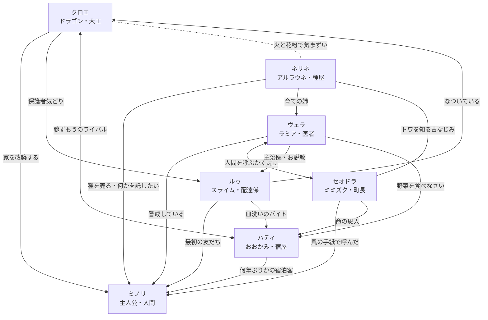

# キャラ設定集

牧場スローライフ×モンスター娘（記号 monmusu・タイトル未定）の、世界とキャラの設定です。試作1（春・28日）に合わせた初版（2026-11-16）。試作1で動くのはクロエ・ルゥ・ネリネの3人。

- 年齢区分のめやす：9+
- 住人はみんな大人の女性。衣装はかわいく、露出はひかえめ
- 同居は「深い友情・家族のような暮らし」として書いています（恋愛の場面はなし）

---

## 1. 世界と街

### つむぎ谷（つむぎだに）

深い霧にかこまれた山あいの谷。小さな町と、谷はずれの荒れた牧場がある。

名前は「いろんな糸をより合わせて、一本の糸をつむぐ」から。

### モン娘だけの町のわけ

- 谷の霧は「自分の居場所をさがしている娘」だけを通す、と言い伝えられている
- 竜、スライム、ハーピー…いろんな種族の里を出た娘たちが、霧に導かれて集まり、町になった
- 男性のモンスターは、それぞれの種族の里で暮らしている。谷は「旅立った娘たちの町」

### 人間との昔の関係

- ずっと昔、人間とモンスターは近くに住んでいた。けれど、おそれと誤解から少しずつ離れていった
- 百年以上前、霧を越えて人間の旅の娘「トワ」がやってきた。住人といっしょに荒れ地を耕し、牧場を作った
- トワの口ぐせは「ちがう手で耕した畑ほど、よく実る」
- 約80年前、年を重ねたトワは人間の町へ帰った。「いつか、また誰かが霧を越えてくる」と言い残して
- それから牧場は荒れ、谷の作物は細く少なくなった。今は森の木の実や、霧の向こうの里との取り引きがたより

### 季節の行事（案）

- **春・芽吹き祭**：谷じゅうに花の種をまく。ネリネが一年でいちばん張りきる日
- **夏・霧晴れの夜**：一年に一晩だけ霧が晴れ、星空と、遠い人間の町の灯りが見える
- **秋・大鍋まつり**：みんなが食材を一つずつ持ちよって、満月亭の大鍋で煮こむ
- **冬・灯の夜**：いちばん長い夜。クロエが町じゅうのランプに竜の火をともす

---

## 2. 主人公

### 名前

- 初期案：**ミノリ**（遊ぶ人が変えられる）
- ほかの候補：ハル／ツグミ

### どんな人

- 人間の女性。20代半ば
- 都会の会社で事務の仕事をしていた。楽しみは、ベランダで育てるミニトマトだけ

### 谷に来た理由

ある春の夜、窓から紙の小鳥が舞いこみ、手のひらの上で手紙になった。

> 牧場の働き手、求む。家つき・経験不問。\
> あなたの居場所が、ここにあるかもしれません。\
> ——つむぎ谷 町長セオドラ

半信半疑で地図のとおり山を越えると、霧の向こうに谷があった。霧が通してくれたのは、彼女もまた「居場所をさがす娘」だったから。

決め手は「自分の手で、何かを最初から育ててみたい」という気持ち。

### 性格（ひかえめ）

まじめで、少しがんばりすぎる。知らないことにわくわくできる。台詞は短めにして、遊ぶ人が自分を重ねやすくする。

### 街の人からの見え方

約80年ぶりの人間なので、町じゅうのうわさの的。

- ルゥ：「ほんものの人間！」と大はしゃぎ
- ハティ：何年ぶりかの宿泊客。着いた夜は満月亭に泊まった
- クロエ：口には出さないが、あの家に灯りがつくのがうれしい
- ネリネ：昔の友だちを思い出してしまい、少し距離をとる
- ヴェラ：「勝手に人間を呼ぶなんて」と警戒
- セオドラ：呼んだ本人。期待しているが、顔には出さない

---

## 3. 相関図

図が出ないときは、各キャラの「ほかの住人との関係」を見てください。

### 主人公が来て変わっていくこと

- クロエ：ずっと見守ってきた家を、やっと「直す」から「育てる」ことができる
- ルゥ：「ただいま」と言える場所ができる
- ネリネ：80年ぶりに牧場へ足を運ぶ
- セオドラ：谷を外とつなぐ、という願いが動きだす
- ヴェラ：人間の医学書を本気で読みはじめ、町長との対立が少しずつほどける
- ハティ：採れたての野菜が届き、満月亭に活気がもどる

---

## 4. キャラクター

| 名前 | 種族 | 街の役目 | 牧場のお手伝い |
|---|---|---|---|
| クロエ | ドラゴン | 大工 | 岩をくだいて石集め |
| ルゥ | スライム | 配達係 | 畑の水やり |
| ネリネ | アルラウネ | 種屋 | 種まき |
| セオドラ | ハーピー（ミミズク） | 町長 | 出荷 |
| ヴェラ | ラミア（白へび） | 医者 | 収穫 |
| ハティ | おおかみ | 宿屋・食堂 | 動物の世話 |

---

### クロエ（ドラゴン娘）

**種族・年齢感**
- ドラゴン（北の火山の竜の一族）
- 20代後半に見える大人。実年齢は「数えるのはやめた」

**見た目と衣装**

深い紫のうろこ（ほお・腕・しっぽに少し）、小さな翼、うしろに流れる2本のつの。黒に近い紫の髪をひとつに結び、瞳は金色。

生成りのシャツに革のエプロンと革の手袋。ゆったりした作業ズボンとブーツ、腰に道具ベルト。

**性格**

クールで物静かな職人。口数は少ないが、仕事はていねいで約束は守る。ほめられるのが苦手。じつは甘い物好き。

**口調**
- 一人称「私」、主人公は「あんた」
- 「〜だ」「〜しろ」と短く言い切る。間（…）が多い
- 例文
  - 「…用か。手短に頼む」
  - 「木はうそをつかない。人より楽だ」
  - 「金と石がそろったら言え。いい部屋にしてやる」
  - 「甘い物？ …別に好きじゃない。少しだけだ」
  - 「あの家に灯りがつくのを、ずっと見たかった」

**街での役目・住まい**

町でただ一人の大工。主人公の家の改築を引き受ける。町の北はずれの「クロエ工房」に住む。

**牧場のお手伝い（同居後）**

畑や牧場の岩をこぶしでくだき、石を集めて倉庫へ。改築用の石が自然にたまる。

**贈り物**
- 大好き：イチゴ
- 好き：石、ジャガイモ
- 苦手：野の花（花粉でくしゃみが出て、小さな火がもれる）

**裏設定**
- 竜の里で宝物庫を守る役を継ぐはずだった。守るより作るほうが好きで、置き手紙をして里を出た
- 長い旅のあと谷に着き、荒れた牧場の家を見た。人間の技と、いろんな種族の技がまざった家。「ちがう者どうしが一つの家を建てた跡」に心を動かされ、大工になった
- 手袋の理由：竜の火が手に宿る体質。気持ちが高ぶると手が熱くなり、木をこがしてしまう
- 秘密：主人公が来るまでの10年、毎年こっそりあの家の屋根を直していた。家がまだ住めたのはそのおかげ
- 悩み：一から家を建てたことがない。作った物を燃やしてしまうのがこわい

**親密度による変化**
- 0♥：用件だけ。目を合わせない
- 2♥：仕事の話をしてくれる。工房のベンチに座らせてくれる
- 4♥：甘い物好きがばれる。竜の里の話を少しする
- 6♥：手袋を外して見せる。屋根の秘密と、大工になった理由を打ち明ける

**ほかの住人との関係**
- ルゥ：工房の水がめで目覚めたルゥを見つけた。保護者気どりだが、本人は否定
- ハティ：腕ずもうのライバル（49勝49敗）。満月亭のこわれたいすは毎回クロエが直す
- ネリネ：花粉でくしゃみ→火が出る。火がこわいネリネとは、おたがい気をつかいすぎて気まずい
- セオドラ：空き工房を世話してくれた恩人。ただし「食えない人」だと思っている
- ヴェラ：手の熱を知る数少ない相手。やけどの薬をもらっている

---

### ルゥ（スライム娘）

**種族・年齢感**
- スライム
- 20代前半に見える大人。年齢は本人も知らない（目覚めたときから今の姿）

**見た目と衣装**

若葉色のぷるぷるのゼリーの体。髪のように見える部分は、肩のあたりで丸くはねている。体の中に、小さな丸い石（核）がうっすら光って見える。

シャツは着ず、スライムの体に、ポケットの多いデニムのオーバーオールと黄色の長靴（オーナー指定）。配達用の肩かけかばん。

立ち絵を頼むときは、胸当てを広くして脇や胸元が見えない形にする（露出ひかえめの決まりと、絵の道具に断られやすい点のため）。

**性格**

元気で人なつこく、ちょっと天然。思ったことがすぐ顔（と体のぷるぷる）に出る。だれにでも同じように明るい。

**口調**
- 一人称「あたし」、主人公は「あなた」
- 語尾「〜だよっ」「〜なの」。うれしいと「ぷるぷるしちゃう」
- 例文
  - 「おはよー！ 今日もぷるぷる元気だよっ！」
  - 「手紙を届けるとね、みんなの顔がぱあってなるの」
  - 「雨の日は体が大きくなるんだ〜。ふふん」
  - 「えっ、人間ってうでがのびないの!?」
  - 「あたしのこと、忘れないでね。…なーんてね！」

**街での役目・住まい**

町の配達係。手紙や荷物を、体をのばしてぴょんぴょん運ぶ。噴水広場の南の、青緑の屋根の小屋に住み、大きな水がめで眠る。

**牧場のお手伝い（同居後）**

体から水をぴゅっと飛ばして、畑の水やりをしてくれる。

**贈り物**
- 大好き：野の花（体の中に浮かべてかざる）
- 好き：カブ、イチゴ
- 苦手：石（おなかの中でごろごろする）

**裏設定**
- 5年前の嵐の夜、クロエ工房の水がめの中で目覚めた。それより前の記憶がない
- 核の表面に、細かな模様が刻まれている。人間の文字に少し似ている（正体は今後のお楽しみ。トワとのつながりにする案もある）
- 悲しくて泣くと、形をたもてずに溶けてしまう。だから人前では絶対に泣かない
- 夏の日ざしに弱く、暑いと少しずつ縮む
- 悩み：過去がないぶん「役に立たなくなったら忘れられるかも」と、ひそかにこわがっている

**親密度による変化**
- 0♥：最初から明るいが、だれに対しても同じ明るさ
- 2♥：主人公を見つけると走ってくる。畑をのぞきに来る
- 4♥：記憶がないこと、核の模様のことを話す
- 6♥：主人公の前でだけ泣ける。溶けても待っていてくれる人ができる

**ほかの住人との関係**
- クロエ：最初に見た顔。家族のようになついている
- ハティ：満月亭で皿洗いのアルバイト。まかないが楽しみ
- ヴェラ：主治医。毎回「水を飲みなさい」としかられる。「ヴェラせんせ」と呼ぶ
- ネリネ：配達のついでに店でひなたぼっこ。ときどき水をかけすぎる
- セオドラ：昼の配達はルゥ、夜の配達は町長。上司のような人

---

### ネリネ（アルラウネ・種屋の店主）

**種族・年齢感**
- アルラウネ（花の精の一族）
- 30歳前後に見える大人。谷でいちばんの古株。年齢は「年輪は数えない主義」

**見た目と衣装**

淡い桃色の花びらが重なったような髪に、大きな桃色の花がひとつ咲いている。ほおや手首に若葉もよう。足首から下は根のようになっていて、店ではときどき鉢に足を入れて休む。

生成りのロングワンピースに深緑のエプロン。外では大きな麦わら帽子。

**性格**

おっとり、やさしい、のんびり。ただし種の話になると早口で止まらない。値引きはしないけれど、おまけはする。商売はしっかり者。

**口調**
- 一人称「わたし」、主人公は「あなた」（最初は「人間さん」）
- 語尾「〜ねぇ」「〜かしら」「〜ですよ」。笑うと「うふふ」、困ると「あらあら」
- 例文
  - 「いらっしゃいませぇ。種屋『こぼれ種』へようこそ」
  - 「カブの種はねぇ、すぐ芽を出す、せっかちな子なの」
  - 「あらあら、根っこを踏まれちゃった。だいじょうぶよぉ」
  - 「摘まれたお花は…少しだけ、さみしいですねぇ」
  - 「あなたの土のさわり方…なつかしいわ」

**街での役目・住まい**

種屋「こぼれ種」の店主。店は広場の北東。店の奥の、日当たりのいい部屋に住む。

**牧場のお手伝い（同居後）**

畑に種をまいてくれる。ネリネが歌うと、作物の育ちが少し早くなる。

**贈り物**
- 大好き：カブ（白くてまるい姿が「芸術」）
- 好き：ジャガイモ、イチゴ
- 苦手：野の花（嫌いではなく、摘まれたのがかわいそう）

**裏設定**
- トワのいちばんの友だちだった。牧場に最初の種をまいたのは、ネリネとトワ
- 店の奥に、トワから預かった木箱がある。「次に来る人間に渡して」と言われた「約束の種」
- 渡してしまえば、トワはもう帰らないと認めることになる。だから80年、箱を開けられずにいる
- 冬は休眠して春まで眠る。目が覚めたとき、だれかがいなくなっているのがこわい
- 主人公にトワの面影を重ねてしまい、それが申し訳なくて、最初は少し距離をとる

**親密度による変化**
- 0♥：ていねいな接客。呼び方は「人間さん」
- 2♥：種の話が止まらなくなる。名前で呼ぶ
- 4♥：何十年ぶりに牧場へ来る。トワの名前を口にする
- 6♥：約束の種の箱を主人公に渡す

**ほかの住人との関係**
- ヴェラ：谷に来たばかりの幼いヴェラを育てた。今は逆に「水やりを忘れないで」と世話を焼かれる
- クロエ：竜の火がこわい。でも腕は信頼していて、店の棚はぜんぶクロエ作
- セオドラ：トワを知る古なじみ。夜にお茶を飲みながら昔話をする
- ハティ：満月亭にハーブを卸している
- ルゥ：かわいい常連。水のかけすぎには少し困っている

---

### セオドラ（ミミズクのハーピー・町長）

**種族・年齢感**
- ハーピー（ワシミミズクの一族）
- 30代後半〜40代くらいに見える、落ち着いた大人

**見た目と衣装**

腕は栗色とクリーム色のまだらの大きな翼で、先に器用な指がある。頭に耳のような羽角。大きな金色の瞳に丸めがね。足は鳥の足。

紺のケープつきロングコートに、首元まで閉じたブラウス。胸に町長の金バッジ。

**性格**

ひょうひょうとして、つかみどころがない。昼はうとうと、夜になると切れ者。冗談好きでちゃっかりしているが、谷の未来をだれより本気で考えている。

**口調**
- 一人称「わたし」、主人公は「きみ」
- 語尾「〜だね」「〜かい？」。口ぐせ「ほう」。昼はあくびまじり
- 例文
  - 「ふわぁ…ほう、きみが手紙の。よく来たね」
  - 「昼の町長は眠いんだ。用事は夜に頼むよ」
  - 「出荷箱の中身は、夜のうちにわたしが運んでおく」
  - 「手紙というのはね、届くまでがいちばんおもしろい」
  - 「急がなくていい。谷は、きみの歩く速さで変わればいい」

**街での役目・住まい**

つむぎ谷の町長。町役場の上の、丸窓のある塔の部屋に住む。毎晩、出荷箱を集めて霧の向こうの里へ売りに飛ぶ。

**牧場のお手伝い（同居後）**

収穫物の箱づめと出荷をまかせられる。夜の市で、いい値で売ってくれる。

**贈り物**
- 大好き：ジャガイモ（夜食のふかし芋が好物）
- 好き：カブ
- 苦手：イチゴ（すっぱいのが苦手）

**裏設定**
- 若いころ、コートで翼をかくして人間の港町に住み、郵便局で配達をしていた。人間の「手紙」の文化が大好き
- 子どものころ、トワに羽の手入れをしてもらった思い出がある
- 「風の手紙」は、居場所をさがす娘にだけ届く魔法の手紙。7年前から毎年春に一通ずつ送り、来てくれたのは主人公が初めて
- 秘密：谷の霧は年々こくなり、いずれ外とつながれなくなる。言い伝えでは「人とモンスターが同じ畑を耕すあいだ、霧はやさしい」。牧場がよみがえれば霧も薄まると考えている
- 主人公に重荷を背負わせたくないので、このことはだまっている

**親密度による変化**
- 0♥：昼に会うと眠そう。あいさつはていねいだが、本心が見えない
- 2♥：夜の町役場に招いてくれる。人間の町の思い出話をする
- 4♥：風の手紙の本当の話をする
- 6♥：霧の秘密を打ち明ける。「町長」ではなく素の顔を見せる

**ほかの住人との関係**
- ヴェラ：人間を呼んだことで真っ向から対立。じつはおたがい、相手の言い分も分かっている
- ハティ：吹雪の夜に倒れていたハティを助けた恩人。今は夜のお茶仲間
- ネリネ：トワを知る古なじみ
- クロエ：谷に来たクロエに空き工房を世話した
- ルゥ：昼の配達はルゥ、夜の配達はセオドラ

---

### ヴェラ（ラミア・医者）

**種族・年齢感**
- ラミア（白へびの一族）
- 20代後半〜30歳くらいに見える大人

**見た目と衣装**

上半身は人、腰から下は長い白へびの体。うろこは真珠色。銀の髪をきっちり三つ編みにして、瞳は赤。

紺のハイネックのブラウスに、すそを長めに仕立てた白衣。首から聴診器。

**性格**

理屈っぽく、皮肉屋で、ぶっきらぼう。けれど患者には誠実で、だれより心配性。押し花が趣味という、かわいい一面がある。

**口調**
- 一人称「私」、主人公は「あなた」
- 冷たい敬語「〜です」「〜しなさい」。ため息まじりの「…まったく」
- 例文
  - 「人間の体は専門外です。けがをしないでください。面倒なので」
  - 「水を飲みなさい。三回目ですよ、ルゥ」
  - 「無理は禁物です。…言っても聞かないんでしょうけど」
  - 「…別に、あなたのために本を読んだわけではありません」
  - 「熱は下がりましたね。…よかった」

**街での役目・住まい**

町の医者。町の東の、薬草の小さな庭がある石づくりの診療所。その奥に住む。

**牧場のお手伝い（同居後）**

長いしっぽで畝のあいだをすべるように進み、かごを一度に三つ運んで収穫してくれる。作物の病気も見つけてくれる。

**贈り物**
- 大好き：野の花（押し花にする）
- 好き：カブ、ジャガイモ（体にいいので）
- 苦手：イチゴ（種のつぶつぶが歯にはさまるのが許せない）

**裏設定**
- 人間に住む場所を追われた一族の生まれ。幼いころ祖母と谷に逃れてきて、ネリネに育てられた
- 「人間はこわいもの」と聞かされて育った。だから町長が人間を呼ぶことに反対した
- 秘密：診療所の奥に、人間の医学書がぎっしり。トワが残していった本を何度も読み返している
- 本当にこわいのは人間ではなく「人間の体を治せないかもしれない」こと。主人公に冷たいのは、そのこわさの裏返し

**親密度による変化**
- 0♥：最低限の会話。「けがをしないで」とくぎを刺す
- 2♥：体調を気にしてくれる。お説教が長くなる
- 4♥：押し花のしおりを見せてくれる。祖母と谷に来た話をする
- 6♥：本当のこわさを打ち明ける。主人公のための薬箱を用意してくれる

**ほかの住人との関係**
- ネリネ：育ての姉。いちばん素直になれる相手
- セオドラ：人間を呼んだことで対立中。でも町長の体調は毎月こっそり気にしている
- ハティ：「野菜も食べなさい」と追いかけまわす。主人公の野菜が届いてからは少し満足げ
- ルゥ：患者。夏はとくに目がはなせない
- クロエ：手の熱を知っている。薬を出すが、クロエが無理をするのでよく怒る

---

### ハティ（おおかみ娘・宿屋の女将）

**種族・年齢感**
- ワーウルフ（北の森の灰色おおかみの一族）
- 20代半ばに見える大人

**見た目と衣装**

灰色のおおかみの耳と、ふさふさのしっぽ。手首から先と足は灰色の毛におおわれていて、手が大きい。金茶色の瞳と、笑うと見える八重歯。

腕まくりした生成りのシャツ、ひざ下のキュロット、大きなオレンジ色のエプロン。頭にバンダナ。

**性格**

豪快で世話焼き、声が大きい。負けず嫌いだけど涙もろく、人情にあつい。料理の腕は町いちばん。じつはかみなりが大の苦手。

**口調**
- 一人称「アタシ」、主人公は「アンタ」
- 語尾「〜だろ！」「〜さ！」。口ぐせ「よっしゃ！」
- 例文
  - 「いらっしゃい！ 満月亭へようこそ！ 腹ペコかい？」
  - 「客室はいつでもぴかぴかさ。いつ旅人が来てもいいようにね」
  - 「クロエ！ 今日こそ腕ずもうで決着つけるよ！」
  - 「アンタの野菜…うまいよぉ…うっ、うう…」
  - 「ヴェラが来た!? アタシはいないって言っといて！」

**街での役目・住まい**

宿屋兼食堂「満月亭」の女将。町の西、大通りぞいの二階建て。二階の奥に住む。

**牧場のお手伝い（同居後）**

動物の世話。最初は動物たちにこわがられるが、慣れると見事に群れをまとめてくれる（動物は試作2以降）。

**贈り物**
- 大好き：ジャガイモ（看板料理「ごろごろ芋の煮こみ」に使う）
- 好き：カブ、イチゴ
- 苦手：石（「食えないもんはいらないよ！」）

**裏設定**
- 狩りがいちばんの名誉という群れで育った。狩りより、とれた物を料理してみんなに食べさせるのが好きだった
- 「料理は群れの仕事じゃない」と言われ、けんか別れのように群れを出た。吹雪で倒れていたところをセオドラに助けられた
- 宿屋なのに、霧のせいで旅人は来ない。それでも客室を毎日みがいてきた。主人公は何年ぶりかの宿泊客
- 秘密：群れの家族にあてた手紙を何通も書いているが、一通も出せていない

**親密度による変化**
- 0♥：初日から大歓迎。ただし「お客さん」あつかい
- 2♥：まかないを出してくれる。「アンタ」呼びになる
- 4♥：かみなりの日に、主人公の前で弱いところを見せる
- 6♥：出せない手紙のことを打ち明け、出す決心をする

**ほかの住人との関係**
- クロエ：腕ずもうのライバル。いすをこわしてはクロエに直してもらう
- セオドラ：命の恩人で、夜のお茶仲間
- ルゥ：皿洗いのバイト。まかないをたっぷり出す
- ヴェラ：野菜を食べろと追いかけてくるので逃げている
- ネリネ：ハーブの仕入れ先

---

## 5. 掛け合いの見本

### ① 満月亭の腕ずもう（クロエ×ハティ）

- ハティ「よっしゃ！ 今日こそ50勝目はアタシがもらう！」
- クロエ「…その前に、先週折ったいすの代金を払え」
- ハティ「うっ…勝ったら払う！」
- クロエ「負けても払え」
- （バキッ。テーブルが真っ二つ）
- クロエ「……引き分けだ。49勝49敗1分け。テーブルも直す」

### ② くしゃみと花びら（クロエ×ネリネ×ルゥ）

- （種屋の棚を直しに来たクロエ）
- ネリネ「いつもありがとう。…少し離れててもいいかしら」
- クロエ「分かってる。手早くすませ…っくしゅん！」
- （ぽっと小さな火）
- ネリネ「ひゃあっ！ わたしの葉っぱ！」
- ルゥ「まかせて！ ぴゅーっ！」
- クロエ「……なぜ私にかける」
- ルゥ「えへへ、もとから消しとこうと思って！」

### ③ 診療所の口論（ヴェラ×セオドラ×主人公）

- ヴェラ「人間を呼ぶなんて。だれが責任をとるんですか」
- セオドラ「わたしだよ。町長だからね」
- ヴェラ「人間が病気になったら？ 私には治せません」
- セオドラ「ほう。治せないのがこわい、と」
- ヴェラ「…そういう話ではありません」
- （戸が開いて、主人公が顔を出す）
- 主人公「あの…畑で手を少し切っちゃって」
- ヴェラ「……座りなさい。すぐ診ます」
- セオドラ「ふふ。では、わたしは寝るとしよう」

### ④ 夏の検診（ヴェラ×ルゥ）

- ヴェラ「ルゥ。また縮みましたね。今日は何杯水を？」
- ルゥ「えっと…コップ一杯！」
- ヴェラ「スライムに一杯は、のどを湿らせただけです」
- ルゥ「でも、配達がいそがしくて…」
- ヴェラ「水がめごと持っていきなさい」
- ルゥ「重くて運べないよぉ！」

### ⑤ はじめての採れたて（ハティ×主人公×ルゥ）

- 主人公「ハティさん、カブがとれたから持ってきたよ」
- ハティ「…カブ。採れたての、カブ…」
- ルゥ「ハティ、泣いてる？」
- ハティ「泣いてない！ カブが目にしみるんだよ！」
- ルゥ「カブってしみるの？」
- ハティ「しみるの！ よっしゃ、今夜はカブのスープだ！ アンタら食べてきな！」

### ⑥ 夜のお茶（ネリネ×セオドラ）

- セオドラ「あの子、トワに似ているね」
- ネリネ「似てませんよ。背もちがうし、笑い方もちがう」
- セオドラ「でも？」
- ネリネ「…土のさわり方が、同じなの」
- セオドラ「ほう。じゃあ、あの箱は」
- ネリネ「まだよ。…もう少しだけ、待ってちょうだい」

### ⑦ 朝の牧場（クロエ×ルゥ×主人公・同居後）

- ルゥ「おはよー！ 水やり終わったよ！ ついでにクロエにも！」
- クロエ「…ついでにするな」
- 主人公「朝ごはんできたよ。二人とも手を洗ってね」
- ルゥ「あたし、全身が手みたいなもんだよ？」
- クロエ「なら全身洗え」

---

## 6. ハートイベントの案

### クロエ
- **2♥ 工房の奥**：工房に招かれ、こげ跡のある木の小鳥が並ぶ棚を見る。手袋の理由を知る
- **4♥ 屋根の上で**：雨の前の日、二人で家の屋根を直す。「毎年、屋根だけは見ていた」と打ち明ける
- **6♥ こげない家**：手袋を外したクロエが、小さな家の模型を見せる。この家を見て大工になったと語る

### ルゥ
- **2♥ 最初の手紙**：配達を手伝う。最後の一通は、ルゥが主人公あてに書いた手紙だった
- **4♥ 核のもよう**：ルゥの核の模様が、主人公の持ってきた本の文字に似ていると気づく
- **6♥ 雨の夜の水たまり**：泣いて溶けてしまったルゥのそばで、形がもどるまで待つ。「忘れないよ」

### ネリネ
- **2♥ 閉店後の種図鑑**：種の話が止まらないネリネに、夜までつき合う
- **4♥ 80年ぶりの畑**：ネリネが牧場に来て、根を土に下ろす。「この土、まだ覚えてる」
- **6♥ 約束の種**：店の奥の木箱を渡される。トワとの思い出と、待ち続けた日々の話

### セオドラ
- **2♥ 真夜中の町役場**：夜だけ開く窓口で、人間の港町で手紙を配っていたころの話を聞く
- **4♥ 返事の来た手紙**：風の手紙を毎年送り続け、届いたのは主人公が初めてだったと知る
- **6♥ 霧晴れの夜**：丘の上で霧の秘密を聞く。「背負わなくていい。ただ、知っていてほしい」

### ヴェラ
- **2♥ 人間のかぜ**：主人公がかぜで診療所へ。夜通し人間の医学書を読んでいたことがばれる
- **4♥ 押し花のしおり**：引き出しに、患者からもらった花の押し花がぎっしり。くれた人を全員覚えている
- **6♥ 本当にこわいもの**：町長との口げんかのあと、「治せないのがこわかった」と打ち明ける

### ハティ
- **2♥ 採れたての煮こみ**：主人公の野菜で作った煮こみを、ハティが泣きながら食べる
- **4♥ かみなりの夜**：かみなりにおびえるハティのそばに、鳴りやむまでいる
- **6♥ 出せない手紙**：群れへの手紙の束を、いっしょに町長へ託す。群れを出た日の話を聞く

---

## 未決定のこと（メモ）

- 恋愛・結婚を入れるか：未定。6♥以降に、どちらにも広げられる余白を残している
- 同居できるハートの数、お金の単位（台詞では仮に「G」）
- ルゥの核の正体（トワとのつながりにする案あり）
